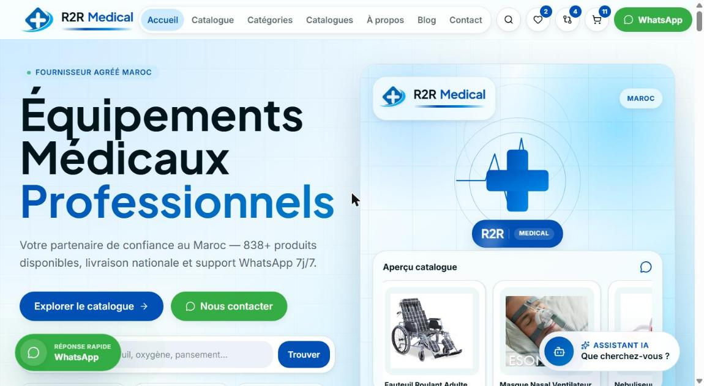
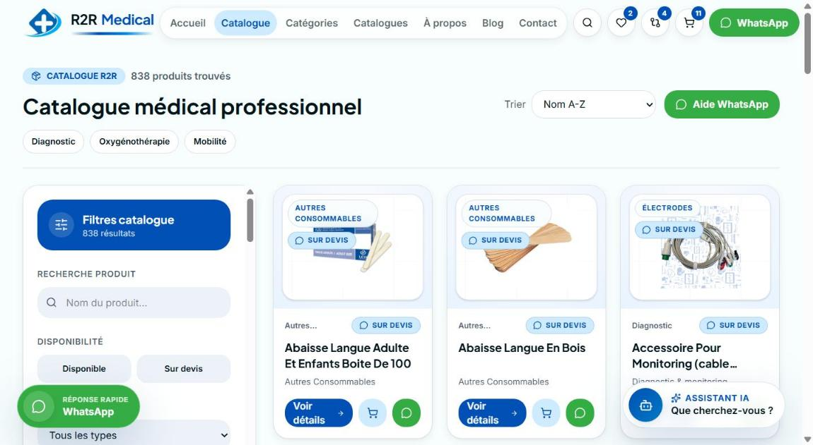

<div align="center">


# R2R Medical

**B2B e-commerce catalogue for a medical equipment supplier in Morocco**

[](https://r2r-medical.netlify.app/)


</div>

---

## Overview

R2R Medical is the web storefront of a Moroccan supplier of professional medical equipment (diagnostics, oxygen therapy, mobility, consumables…). Instead of a classic checkout, the site is built around **quote requests**: visitors browse a catalogue of 838+ products, build a quote, and send it straight to the sales team on WhatsApp — the channel B2B buyers in Morocco actually use.

**Live demo → [r2r-medical.netlify.app](https://r2r-medical.netlify.app/)**

## Screenshots

| Home | Catalogue |
| --- | --- |
|  |  |

## Features

**Catalogue**
- 838+ products organised by category, with filters (availability, type, category) and sorting
- Instant search with suggestions and a command palette (`Ctrl / ⌘ + K`)
- Product pages with image lightbox, quick-view modal, related products and "recently viewed"
- Side-by-side product comparison and favourites list

**Sales & quotes**
- Quote cart (`/devis`) that turns the selection into a pre-filled WhatsApp message
- Smart WhatsApp routing to the right contact, floating quick-reply button
- Built-in shopping assistant (chat) to help buyers find the right product
- Dedicated pages for public tenders, compliance and client references

**Content & SEO**
- Blog, product reviews and a medical glossary
- Per-page meta tags, sitemap, robots.txt and web manifest
- French / Arabic interface (RTL support)

**UX**
- Responsive, mobile-first layout with dark mode
- Interactive delivery map of Morocco, testimonials, trust badges
- Cookie consent, back-to-top, reading progress and keyboard shortcuts

**Admin**
- `/admin` page to review the catalogue and export product overrides

## Tech stack

| Layer | Tools |
| --- | --- |
| Framework | [TanStack Start](https://tanstack.com/start) (React 19, SSR) + TanStack Router |
| Language | TypeScript |
| Styling | Tailwind CSS 4, shadcn/ui (Radix UI primitives), Framer Motion |
| Data & forms | TanStack Query, React Hook Form, Zod |
| Assistant | OpenAI API (`gpt-4o-mini`) via a server function |
| Tooling | Vite, ESLint, Prettier, Bun |
| Hosting | Netlify |

## Getting started

**Prerequisites:** Node.js 20+ and [Bun](https://bun.sh) (or npm).

```bash
git clone https://github.com/elmehdi-sekrare/r2r-medical-your-partner.git
cd r2r-medical-your-partner

bun install        # or: npm install
bun run dev        # or: npm run dev
```

The assistant needs an OpenAI key. Create a `.env` file at the project root:

```env
OPENAI_API_KEY=your_key_here
```

### Scripts

| Command | Description |
| --- | --- |
| `bun run dev` | Start the dev server |
| `bun run build` | Production build |
| `bun run preview` | Preview the production build |
| `bun run lint` | Lint the codebase |
| `bun run format` | Format with Prettier |

## Project structure

```
src/
├── routes/        # File-based routes (catalogue, produit, devis, blog, admin…)
├── components/    # UI and feature components (ui/ = shadcn primitives)
├── data/          # Products, blog posts, glossary
├── lib/           # i18n, SEO helpers, quote & WhatsApp logic, utilities
├── hooks/         # Custom React hooks
└── assets/        # Images and brand assets
docs/
├── screenshots/   # README screenshots
└── cahier-des-charges-r2r-medical.html   # Functional specification (FR)
```

## Author

**El Mehdi Sekrare** — [GitHub](https://github.com/elmehdi-sekrare)

---

© R2R Medical. All rights reserved.
